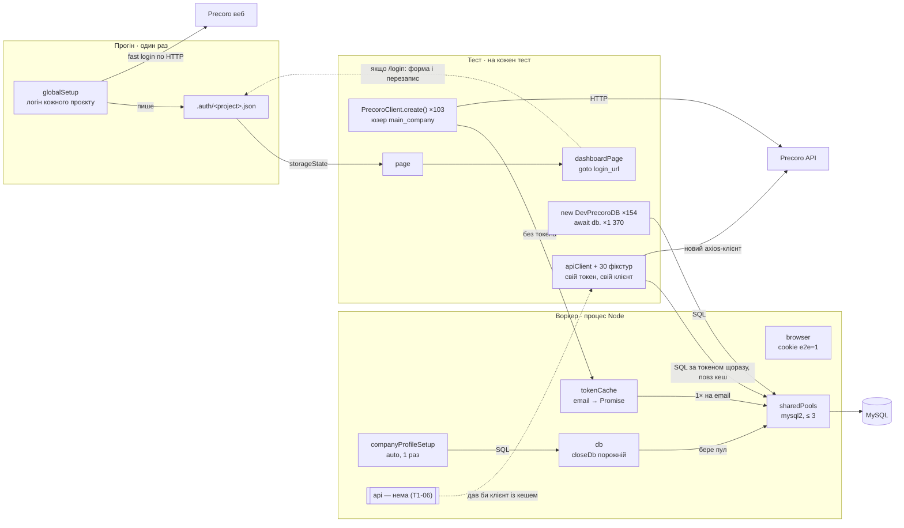
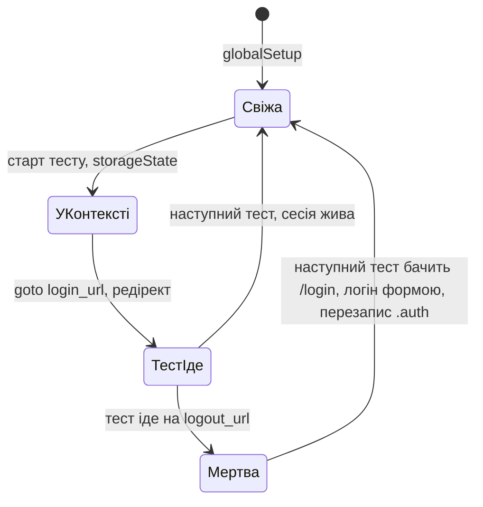

# TAF: хто що створює на рівнях прогону, воркера і тесту

Стан на 2026-11-03, `origin/develop` `8fbee902`. Числа з `git grep` по цьому коміту. Посилання `файл:рядок` на `precoro-e2e-playwright`. Артефакт зі схемами: https://claude.ai/artifact/XAR9gowY8Y4DBfNsjjymPG. Ця сторінка показує, як частини складаються разом. Як визначається, де і що запускати, описано в `taf-runtime.md`.

## Скільки це коштує

- Before Hooks (фікстури й логін): 3,62 год, 12% нічного 30.09 (`01-context/audit/nightly-run-2026-09-30.md`).
- Before Hooks у середньому 3,4 с на тест, `dashboardPage` 0,8 с, нічний 294 під Xdebug (`05-roadmap/tasks/T1-32.md`).
- SQL за токеном займає мілісекунди. Час іде на навігацію, логін і налаштування через API, які фікстури роблять на кожен тест.

## Загальна картина

- Сесія і пул БД спільні: сесія одна на проєкт за прогін, пул один на процес воркера.
- Клієнт API створюється на кожен тест. `apiClient` (`base_fixtures.ts:322`) і 30 фікстур беруть токен через `db.getUserApiTokenByEmail` і передають його явно. Явний токен має пріоритет, тому `tokenCache` (`base_service.ts:52`) вони обминають.
- Кеш працює лише для 103 викликів `PrecoroClient.create()` без аргументів. Ці виклики отримують `Constants.user_name`, тобто юзера `main_company` (`base_service.ts:42-45`), і всі стоять у спеках `main_company`, тож юзер правильний.

## Життя сесії проєкту

Сесію вбиває будь-який тест, що йде на `logout_url`: `LoginPage.create()` (`login_page.ts:15`) робить це першим кроком, а `logout_url` згадується 39 разів у 13 файлах. Розплачується наступний тест того ж проєкту: `dashboardPage` (`base_fixtures.ts:330`) логіниться формою і перезаписує файл. `@sanity` при `CLEAR_CACHE=true` проходить цей шлях свідомо.

## Де живе кожен факт

| Що | Де | Хто пише | Хто читає |
| --- | --- | --- | --- |
| Сесія проєкту | `.auth/<project>.json` (`auth-dir.ts`) | `globalSetup`; `dashboardPage`, коли сесія мертва | Playwright через `storageState` у кожному тесті |
| Головний юзер проєкту | `COMPANY_MAIN_USERS` (`auth-helpers.ts`) | вручну | `globalSetup`, `apiClient`, `dashboardPage` |
| API-токен юзера | MySQL, таблиця `api_token` | продукт | `getUserApiTokenByEmail`: 84 виклики поза шарами API і БД, з них 30 у фікстурах |
| Кеш токенів | `BaseClient.tokenCache`, статик процесу (`base_service.ts:52`) | `BaseClient.tokenFor` | лише `create()` без явного токена: 103 виклики |
| З'єднання з БД | `DataBase.sharedPools`, mysql2, `connectionLimit: 3` (`db_connection.ts:24`, `:40`) | перший `new DevPrecoroDB` у процесі | фікстура `db` (`base_fixtures.ts:171`) і 154 місця `new DevPrecoroDB` / `getDevDb()` |
| HTTP-клієнт | `APIRequest` → `axios.create` (`requests.ts:118`) у кожному клієнті | конструктор `PrecoroClient` | 184 `PrecoroClient.create(` і 37 `new PrecoroClient(` |
| Налаштування компанії | `PROFILES` → `companyProfileSetup` (`base_fixtures.ts:191`) | фікстура воркера, один раз | усі тести проєкту |

Розбіжність: `taf-runtime.md`, розділ 5, каже, що токен береться через `BaseClient.create()` з кешем. Для класу це правда, але `apiClient` і 30 фікстур передають токен явно і кеш обминають.

## Що закрито і що ні

- ✓ Сесія логіниться один раз на проєкт, fast login по HTTP.
- ✓ Одне пуло БД на процес, до 3 з'єднань.
- ✓ Компанія налаштовується один раз на воркер.
- ✗ `apiClient` і 30 фікстур роблять SQL за токеном на кожен тест, повз кеш.
- ✗ На кожен тест новий axios-клієнт; кеш формату дати компанії гине разом із ним.
- ✗ Фікстури `api` рівня воркера нема (T1-06).
- ✗ Тести з `logout_url` вбивають спільну сесію, наступний тест логіниться формою (T1-03).
- ✓ 103 виклики `create()` без аргументів отримують юзера `main_company`; усі вони в спеках `main_company` (`test_api` 101, `test_common_functional` 2).
- ✓ Токени ніхто не перевипускає: `generateApiTokenForCurrentSessionUser` не має викликів, тож закешований токен не застаріває.
- ? `closeDb()` порожній (`db_connection.ts:94`), `closeAllPools()` (`:96`) ніхто не викликає: пул живе до кінця процесу.

## Що досі руками

- `REFRESH_AUTH=true` локально, коли змінився пароль або сесії застаріли (`global-setup.ts:39`); CI завжди логіниться заново.
- `PW_WORKERS` у Docker, якщо 4 воркери не влазять у пам'ять.
- Новий проєкт: рядок у `COMPANY_MAIN_USERS` і, якщо потрібне налаштування компанії, профіль у `PROFILES`.
